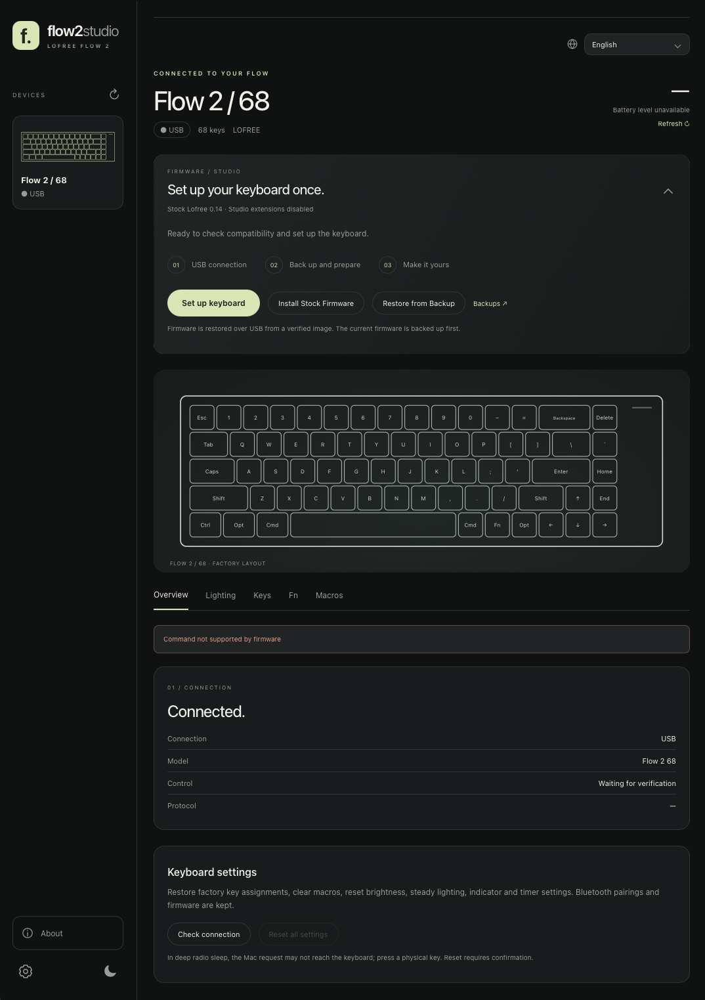
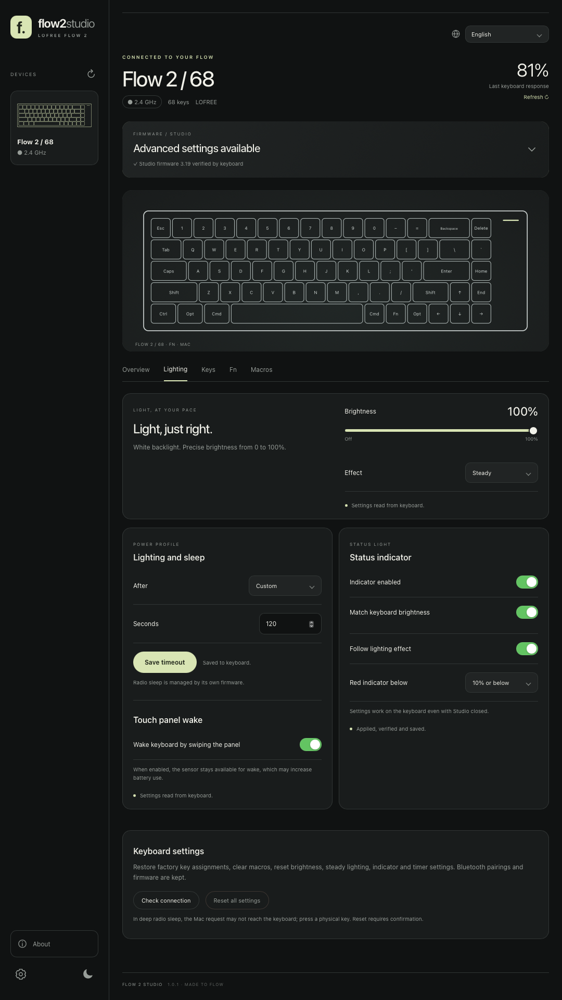
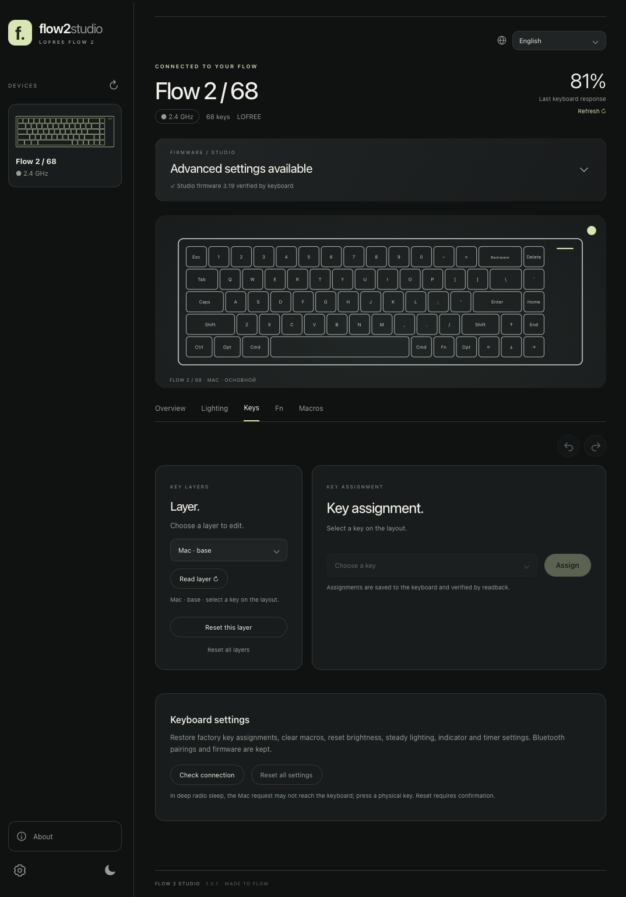
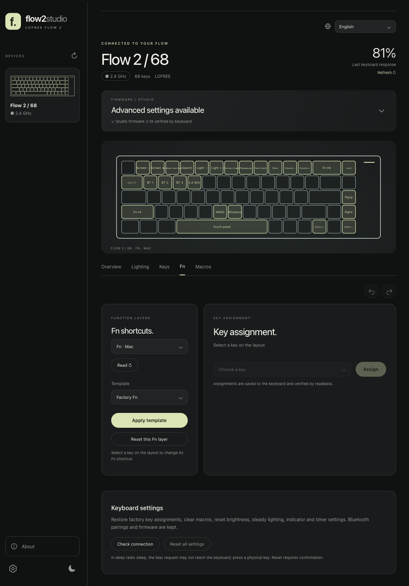
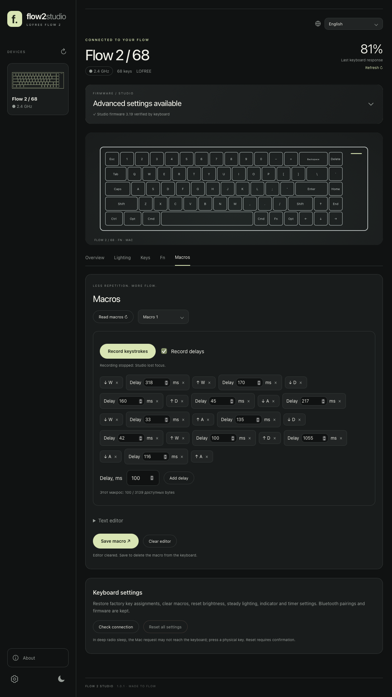

# Flow2Studio

Configuration app for Lofree Flow 2 keyboards.

[Releases](https://github.com/BagaT2K/Flow2Studio/releases) · [Support development](https://ko-fi.com/bagat2k/tip)

Build targets macOS 12 and later on Apple Silicon and Intel. Windows support is planned.

Designed for standard Flow 2 **68, 84 and 100** models.

> [!CAUTION]
> **TESTED ONLY ON FLOW 2 68**
>
> Flow 2 84 and 100 have not been tested on physical devices.
>
> **Flash firmware at your own risk.** A failed or interrupted update may leave the keyboard unusable.

## Installation

1. Download the DMG from [Releases](https://github.com/BagaT2K/Flow2Studio/releases).
2. Open it and drag Flow2Studio into Applications.
3. Launch Flow2Studio.

## First connection

The firmware panel appears when you first connect the keyboard. Studio firmware enables the app's additional controls.

1. Connect the keyboard with a USB cable and switch it to USB mode.
2. Select its USB connection in Flow2Studio.
3. Click **Set up keyboard**, review the warning and confirm.
4. Wait for the operation to finish. Do not disconnect the cable or close the app.

Studio saves and verifies a firmware backup before writing. After setup, the lighting, key, Fn and macro controls become available.

- **Install Stock Firmware** installs the factory firmware bundled with the app.
- **Restore from Backup** lets you select a saved firmware image, including your original backup.

## Lighting

Adjust backlight brightness, effects, animation speed and sleep timeout. Configure the indicator separately or sync its brightness with the keyboard. Set a low-battery warning threshold and enable wake from the touch panel.

## Keys

Remap keys across layers, assign shortcuts and macros, and highlight changed keys. Restore individual layers to their defaults or undo changes made during the current session.

## Fn

Customize Fn-layer assignments using the factory layout or the F1–F12 template.

## Macros

Record key presses and shortcuts with delays. Edit the sequence, save it and assign the macro to a key.

## Connection and battery

- Battery status in the macOS menu bar.
- USB, Bluetooth and 2.4 GHz connections.
- Settings queued while the keyboard is asleep and applied when it responds.
- Optional 2.4 GHz connection hold while configuring the keyboard.

## Languages

English, Chinese, Japanese, Korean, Spanish, German and Russian. English is the default; the app remembers your selection.

## License

Original project code is licensed under the [MIT License](LICENSE). Third-party components and assets retain their own terms.

Copyright © 2026 [BagaT2K](https://github.com/BagaT2K).
