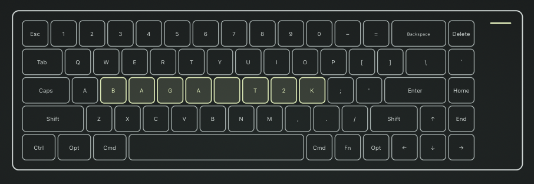
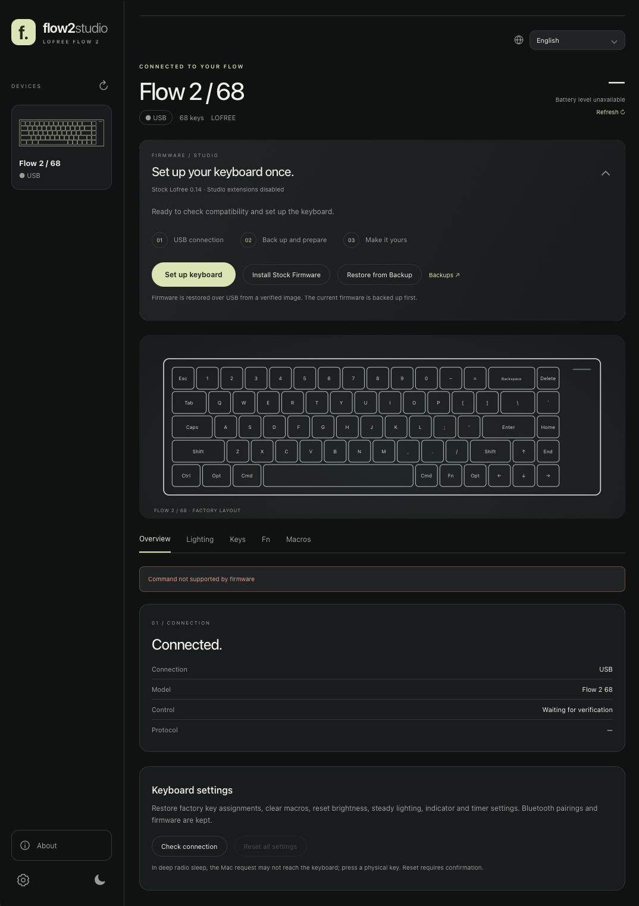
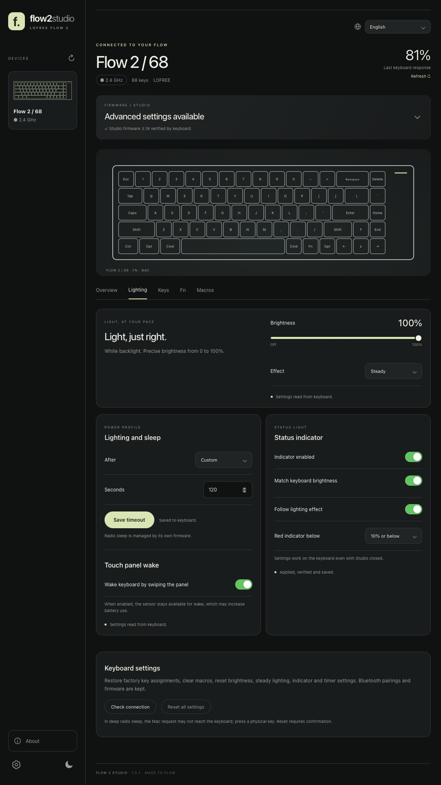
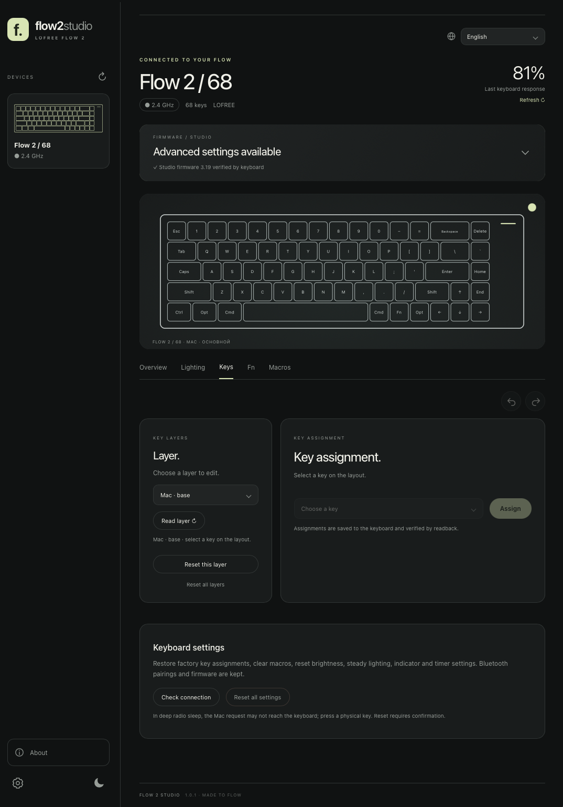
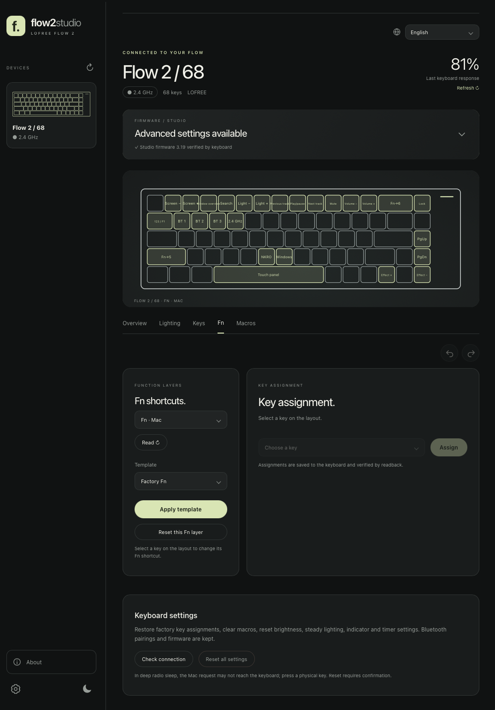
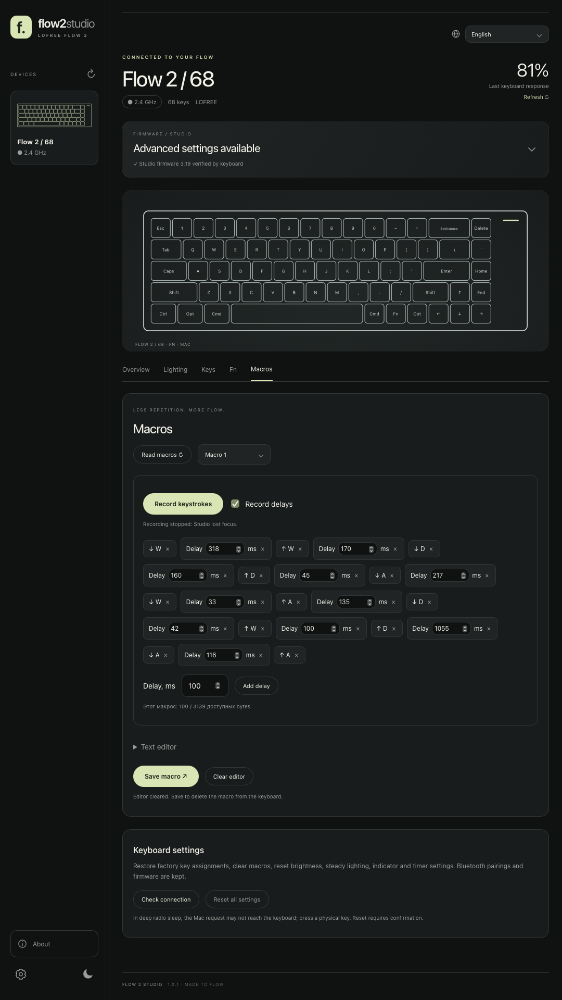
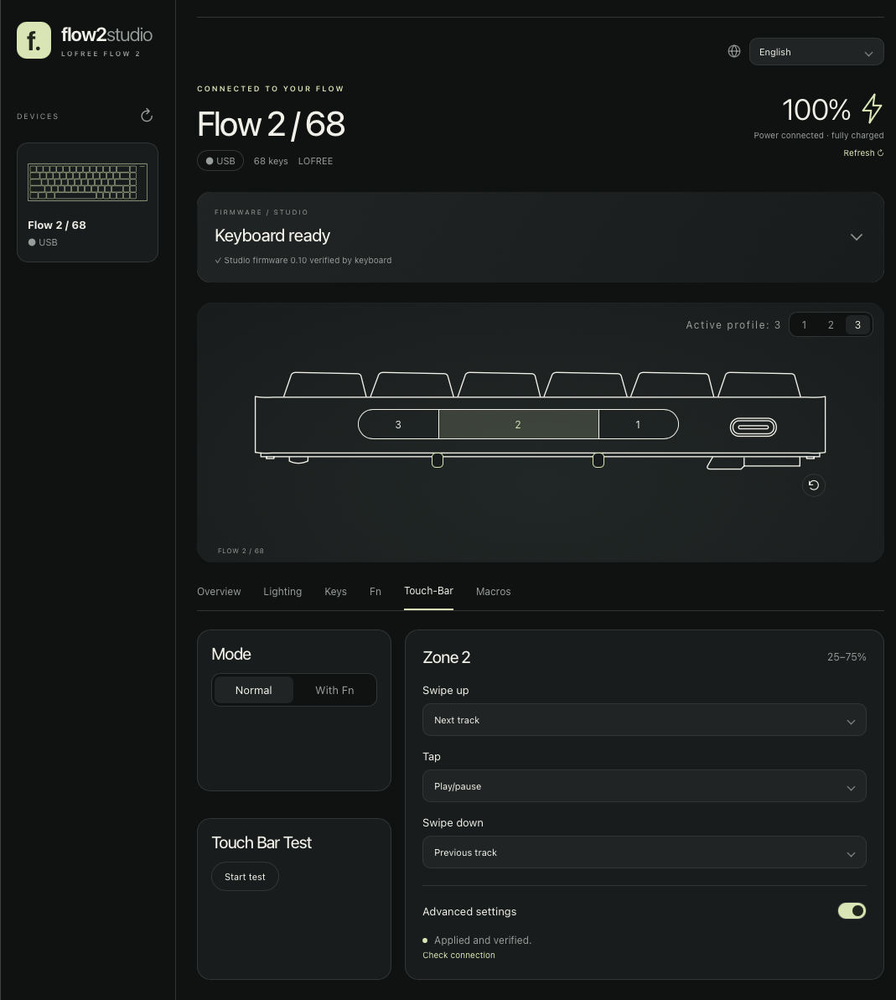

# Flow2Studio



Configuration app for Lofree Flow 2 keyboards.

**Flow2Studio 1.1.0** includes **Studio firmware 0.10**, based on Lofree factory firmware 0.14.

[Releases](https://github.com/BagaT2K/Flow2Studio/releases) · [Support development](https://ko-fi.com/bagat2k/tip)

Build targets macOS 12 and later on Apple Silicon and Intel, and Windows 10 (2004) / Windows 11 x64 (see [Windows](#windows); tested only on a Flow 2 84).

Designed for standard Flow 2 **68, 84 and 100** models. Flow 2 for Mac models are not supported.

> [!CAUTION]
> **TESTED ONLY ON FLOW 2 68**
>
> Flow 2 84 and 100 have not been tested on physical devices.
>
> **Flash firmware at your own risk.** A failed or interrupted update may leave the keyboard unusable.

## Installation

1. Download the DMG from [Releases](https://github.com/BagaT2K/Flow2Studio/releases).
2. Open it and drag Flow2Studio into Applications.
3. Launch Flow2Studio.

> [!IMPORTANT]
> **First launch on macOS**
>
> Flow2Studio is not signed with an Apple Developer ID or notarized, so macOS may block the first launch.
>
> 1. Move Flow2Studio to Applications and try opening it.
> 2. Open **System Settings → Privacy & Security**.
> 3. Scroll to **Security** and click **Open Anyway** next to Flow2Studio.
> 4. Confirm with your password or Touch ID if prompted, then click **Open**.
>
> Only approve a copy downloaded from this repository's Releases. Disabling Gatekeeper is not required.

### Windows

The Windows host (`windows/`, C# with WebView2) uses the same web UI and firmware bundle as the macOS app.

1. Install the [.NET 10 SDK](https://dotnet.microsoft.com/download). The WebView2 runtime ships with Windows 11.
2. Build from the repository root:

   ```powershell
   powershell -ExecutionPolicy Bypass -File scripts\build-windows.ps1
   ```

3. Run `dist\Flow2Studio-windows\Flow2Studio.exe`. Keep `ui\` and `firmware\` next to the exe.

Closing the window keeps Flow2Studio in the system tray; use **Quit** from the tray menu to exit. Settings and backups are stored in `%APPDATA%\Flow2Studio`.

#### Firmware driver (once per PC)

Installing or restoring firmware on Windows needs the **WinUSB** driver for the keyboard's bootloader. Lighting, keys, Fn, macros and Touch Bar do not need it: they use the standard Windows keyboard driver.

The bootloader is built into the keyboard's WB32 chip and appears as **WB Device in DFU Mode** (USB ID `342D:DFA0`). It does not tell Windows which driver to use, so Windows leaves it without one. Flow2Studio checks for WinUSB before switching the keyboard into the bootloader. If it is missing, the app stops and writes nothing.

Install it once with [Zadig](https://zadig.akeo.ie):

1. Connect the keyboard with a USB cable.
2. Enter recovery mode: hold **Fn**, then **left Shift**, then press **Esc**. The keyboard stops typing and Windows shows **WB Device in DFU Mode**.
3. Open Zadig. If the device is not listed, enable **Options → List All Devices**.
4. Select **WB Device in DFU Mode** and check that **USB ID** shows `342D` `DFA0`.
5. Select **WinUSB** as the target driver and click **Install Driver**.
6. Unplug and reconnect the keyboard. It returns to normal mode.
7. In Flow2Studio, click **↻** and try again.

> [!CAUTION]
> Only install WinUSB on `342D:DFA0`. Do not change the driver of the keyboard in normal mode (`388D:xxxx`); it would stop typing until the driver is rolled back in Device Manager.

The driver applies to every USB port and every Flow 2 on that PC. Zadig installs a self-generated certificate to sign the driver; this is how Zadig works and is required for WinUSB on devices without built-in driver descriptors.

## First connection

The firmware panel appears when you first connect the keyboard. Studio firmware enables the app's additional controls.

1. Connect the keyboard with a USB cable and switch it to USB mode.
2. Select its USB connection in Flow2Studio.
3. Click **Set up keyboard**, review the warning and confirm.
4. Wait for the operation to finish. Do not disconnect the cable or close the app.

Studio saves and verifies a firmware backup before writing. After setup, the lighting, key, Fn, macro and Touch Bar controls become available.

- **Install Stock Firmware** installs the factory firmware bundled with the app.
- **Restore from Backup** lets you select a saved firmware image, including your original backup.



## Lighting

Adjust backlight brightness, effects, animation speed and sleep timeout. Configure the indicator separately or sync its brightness with the keyboard. Set a low-battery warning threshold and enable wake from the touch panel.



## Keys

Remap keys across layers, assign shortcuts and macros, and highlight changed keys. Restore individual layers to their defaults or undo changes made during the current session.



## Fn

Customize Fn-layer assignments using the factory layout or the F1–F12 template.



## Macros

Record key presses and shortcuts with delays. Edit the sequence, save it and assign the macro to a key.



## Touch Bar

Set up profiles with one, two or three zones. Adjust the zone boundaries and assign actions to taps and swipes, with separate assignments for gestures while holding Fn.

Switch profiles from the **Touch Bar** tab, or assign a specific profile or **Next Touch Bar Profile** to a key, an Fn shortcut or a Touch Bar gesture. The app shows which profile is active.



## Connection and battery

- Battery status in the macOS menu bar.
- USB, Bluetooth and 2.4 GHz connections.
- Settings queued while the keyboard is asleep and applied when it responds.
- Optional 2.4 GHz connection hold while configuring the keyboard.


## Languages

English, Chinese, Japanese, Korean, Spanish, German and Russian. English is the default; the app remembers your selection.

## Bug reports

Found a bug? [Open an issue](https://github.com/BagaT2K/Flow2Studio/issues).

Please include:
- App and firmware versions.
- Keyboard model: 68, 84 or 100.
- Connection: USB, Bluetooth or 2.4 GHz.
- macOS version.
- Steps to reproduce, expected behavior and what happened.
- Screenshots or error messages, if available.

## License

Original project code is licensed under the [MIT License](LICENSE). Third-party components and assets retain their own terms.

Copyright © 2026 [BagaT2K](https://github.com/BagaT2K).
